## Đề bài

*CRYPT03*

*Mô tả*

*give_to_player.zip*

*`nc 59.153.245.196 1338`*

Gói đính kèm có ba tệp: `chall.py` (dịch vụ), `aes.py` (một bản AES viết bằng Python, cho phép chọn số vòng) và `core.c` (phần hỗ trợ AES-NI để chạy nhanh). Kết nối vào dịch vụ sẽ hiện lời chào cùng một menu nhỏ:

```text
SEVENFOLD / INTEGRAL SIX
PUBLIC={"rounds": 6, "nonce": "80e5faeca1828e3c", "flag_ct": "57e00d56...", "bases": [...], "pt": "000...0", "ct": "5d3d1ede1baef0f9beb46d8ea6256283"}
1. Encrypt
2. Get structure bitmap
3. Exit
```

Flag được mã hóa bằng AES-128 rút xuống còn sáu vòng, chạy ở chế độ CTR. Cái tên trên banner gần như nói luôn hướng tấn công: “integral”, sáu vòng.

Flag cuối cùng là:

```text
CSCV2026{sevenfold_aes7r_gpu_2_rtx_5090_hehe_hihi}
```



## Hướng giải

### Dịch vụ cho ta những gì

`chall.py` giữ một key ngẫu nhiên, một nonce và sáu “base” 16 byte ngẫu nhiên cho mỗi instance. Flag dài 50 byte, tức bốn khối CTR, và được mã hóa như sau: `flag ^ AES6(nonce || counter)`.

Lựa chọn 1 là một encryption oracle với đúng một giới hạn:

```python
if len(p) != 16 or p[:8] == nonce and int.from_bytes(p[8:], 'little') < (len(flag)+15)//16:
    print('Rejected')
```

Oracle từ chối bốn khối counter dùng để mã hóa flag, ngoài ra không chặn khối nào khác. Phép so sánh dùng byte thô với độ dài cố định, nên không có mẹo phân tích cú pháp nào giúp lách qua một khối counter bị chặn. Ta phải khôi phục key.

Lựa chọn 2 mới là phần đáng chú ý. Nó nhận `group` (từ 0 đến 3) và `structure` (từ 0 đến 5), rồi chạy vòng lặp này trong `core.c`:

```c
for (uint64_t i=0;i<count;i++) {          // count = 2^32
    p[0] = (uint8_t)i;
    p[5] = (uint8_t)(i>>8);
    p[10] = (uint8_t)(i>>16);
    p[15] = (uint8_t)(i>>24);
    __m128i x = run(k, _mm_loadu_si128((const __m128i*)p));
    _mm_storeu_si128((__m128i*)c, x);
    uint32_t idx = ((uint32_t)c[loc[3]]<<24) | ((uint32_t)c[loc[2]]<<16) | ((uint32_t)c[loc[1]]<<8) | c[loc[0]];
    __atomic_fetch_xor(bits + (idx>>6), 1ULL << (idx&63), __ATOMIC_RELAXED);
}
```

Các byte 0, 5, 10 và 15 tạo thành đường chéo chính của trạng thái AES. Mười hai byte còn lại lấy từ `bases[structure]`; mọi base đều có `b[1] = nonce[1] ^ 0xff`, nên một structure không thể trùng khối counter. Dịch vụ mã hóa đủ 2^32 giá trị trên đường chéo, chọn bốn byte ciphertext rồi lật bit `idx` trong một mảng 2^32 bit. Thứ ta nhận được là bitmap parity 512 MiB: bit `v` bật khi bốn byte đầu ra được chọn có giá trị `v` xuất hiện số lần lẻ.

`group` quyết định bốn byte ciphertext nào được đọc:

```text
group 0: c[0], c[13], c[10], c[7]
group 1: c[4], c[1],  c[14], c[11]
group 2: c[8], c[5],  c[2],  c[15]
group 3: c[12], c[9], c[6],  c[3]
```

Mỗi group ứng với một đường chéo đầu ra. Sau ShiftRows cuối cùng, đường chéo đó thẳng hàng với một cột của trạng thái trước vòng 6. Bản đầu của gói đính kèm chỉ có group 0. Trong lúc thi, file được cập nhật cùng prompt `group`; chính thay đổi này mới cho phép khôi phục đủ key.

Nhìn bitmap thật thì nó chỉ như nhiễu:



Mật độ của bitmap là một phép kiểm tra hợp lý. Có 2^32 đầu vào rơi vào 2^32 bucket, nên số lần xuất hiện ở mỗi bucket xấp xỉ phân phối Poisson(1); xác suất một bucket có số lần xuất hiện lẻ là `(1 - e^-2) / 2 = 0.4323`. File tải về cũng có mật độ 0.4323.

### Tính chất tích phân

Xét một tập gồm 2^32 plaintext, trong đó một đường chéo lần lượt nhận mọi giá trị còn mười hai byte kia được giữ nguyên. Theo dõi tập này qua AES:



Sau vòng 1, đường chéo biến thành một cột đầy đủ. Sau vòng 2, mỗi cột phụ thuộc vào mọi byte của cột đó; đến vòng 3, mỗi cột là một song ánh của đầu vào 32 bit. Sau AddRoundKey thứ tư, mọi byte của trạng thái `s4` đều cân bằng, nghĩa là XOR trên toàn bộ 2^32 bản mã bằng 0. Đây là tính chất Square kinh điển, và nó đúng với mọi key.

Vòng 5 và 6 vẫn nằm giữa `s4` và ciphertext, nên ta bóc chúng từ phía ciphertext. Với group `g`, bốn byte ciphertext cho ta cột `g` của trạng thái trước vòng 6:

```text
s5[j][g] = InvS(c[loc_j] ^ k6[loc_j])        j = 0..3
```

Vòng 5 kết thúc bằng MixColumns, vốn là phép tuyến tính. Vì vậy ta có thể đưa key qua phép biến đổi này bằng key tương đương quen thuộc `k5' = InvMixColumns(k5 column g)`. Khi đó một byte của `s4` là:

```text
s4 byte = InvS( XOR_j M[r][j] * s5[j][g]  ^  k5'[r] )
```

Trong đó `M` là ma trận InvMixColumns. Với một hàng `r`, byte này phụ thuộc vào năm byte key: bốn byte của `k6` trên đường chéo và một byte `k5'`. Đoán đúng thì XOR trên toàn bộ structure bằng 0. Đoán sai vẫn có xác suất 2^-8 cho kết quả đó.

### Vì sao bitmap parity là đủ

Phép kiểm tra lấy XOR của `f(v)` trên toàn bộ 2^32 bản rõ, với `v` là bốn byte đầu ra. Nếu giá trị `v` xuất hiện `n` lần, nó đóng góp `n * f(v)` trong GF(2), tức là `f(v)` khi `n` lẻ và không đóng góp gì khi `n` chẵn. Vì thế:

```text
XOR over texts of f(v)  =  XOR over {v : bit[v] = 1} of f(v)
```

Bitmap giữ đúng thông tin mà phép tấn công cần, nén ciphertext 64 GiB xuống còn 512 MiB.

### Partial sums

Mỗi hàng có 2^40 khả năng của key và khoảng 2^31 bit bật trong mỗi bitmap. Thử thẳng sẽ tốn 2^71 phép tính. Mẹo partial sums của Ferguson và cộng sự đoán từng byte một rồi gộp dữ liệu sau mỗi lần đoán, chỉ giữ lại parity:



```text
step A  guess k0,k1   (v0,v1,v2,v3)  2^32 bits  ->  (t1,v2,v3)  2^24 bits
step B  guess k2      (t1,v2,v3)               ->  (t2,v3)     2^16 bits
step C  guess k3      (t2,v3)                  ->  t3          256 bits
step D  guess k5'     t3                       ->  8-bit sum, keep the key if it is 0
```

Mỗi bảng trung gian là một vector bit nên có thể chứa trên GPU.

Bản CUDA đầu tiên lật từng bit đầu ra ứng với mỗi bit đầu vào, mất khoảng 92 giây cho mỗi giá trị key ngoài cùng. Chạy 256 giá trị với nhiều structure sẽ ngốn gần hết một ngày. Bản viết lại xử lý nguyên hàng 256 bit:

- Ở bước B và C, đầu ra của một lần đoán key là XOR các hàng đã dịch bởi `g(v ^ k)`. Dịch một hàng 256 bit đi `u` vị trí tương đương hoán vị word (`u >> 5`) cộng với xoay bit trong từng word (`u & 31`). Mỗi CUDA block tính trước 32 bản xoay bit của một đoạn hàng trong shared memory, nhờ đó mỗi thread chỉ cần 8 lần đọc và 8 phép XOR cho mỗi hàng.
- Bước A dùng cùng ý tưởng theo chiều đảo, rồi chuyển vị ma trận bit 256 x 256 trong shared memory.
- Bước D xử lý theo kiểu bitslice: bảng 64 KB lưu, với mỗi `t` và bit đầu ra, mask 256 bit ứng với các giá trị `k5'`; nhờ vậy phép kiểm tra tổng bằng 0 chỉ cần vài phép AND.

Trên laptop dùng RTX 3050, cách này rút một lượt xuống còn khoảng 1,1 giây (bước A 0,24 giây, B 0,17 giây, C+D 0,66 giây).

Trước khi mất hàng giờ xử lý dữ liệu từ server, mã được thử trên bitmap tự tạo bằng `core.c` của challenge và key `000102...0f`. Solver khôi phục đúng các byte dự kiến. Với một structure, 63,3% số tổ hợp `(k0..k3)` còn lại, khớp với `1 - (1 - 2^-8)^256 = 0.632`: một tổ hợp sai vẫn qua lọc nếu bất kỳ giá trị nào trong 256 giá trị `k5'` cho tổng bằng 0.

Con số đó cũng cho biết cần tải bao nhiêu structure:



Với một hàng, năm structure chỉ để lại khoảng một key sai trong 2^32 khả năng.

### Group 0

Năm structure của group 0 và đủ 256 lượt duyệt giá trị ngoài cùng chỉ còn đúng một ứng viên:

```text
k6[0]=0x41  k6[13]=0x16  k6[10]=0x66  k6[7]=0x96     k5'(row 0)=0x2a
```

Ứng viên này cũng vượt qua structure thứ sáu và cả bốn hàng, nhờ đó ta có toàn bộ `k5'` và suy ra được cột 0 của `k5`: `b9 ba bf 16`.

### Dùng key schedule

Biết một cột của `k5` sẽ liên kết các byte của `k6` qua key schedule AES-128. Với `w20..w23 = k5` và `w24..w27 = k6`:

```text
w24 = w20 ^ SubWord(RotWord(w23)) ^ Rcon(6)
w23 = w27 ^ w26
```

Tính lần lượt theo từng hàng cho ta các quan hệ như `k6[0] = w20[0] ^ S(k6[13] ^ k6[9]) ^ 0x20`, từ đó xác định ngay `k6[9] = 0x3b`. Các hàng còn lại liên hệ `k6[1]`, `k6[2]`, `k6[3]` với những byte mà ta sắp phải tìm.

### Group 3 và 1, chạy đua với thời gian

Đến lúc gói đính kèm được cập nhật thì không còn nhiều thời gian, còn server chỉ tải được khoảng 1,8 MB/s. Tải năm file 512 MiB cho mỗi group là không thực tế, nên chỉ lấy hai structure mỗi group. Hai điểm sau bù lại phần dữ liệu ít hơn:

- Mỗi ứng viên được kiểm tra đồng thời trên cả bốn hàng InvMixColumns (chúng dùng chung `k0..k3`, mỗi hàng có byte `k5'` riêng), vì vậy key sai chỉ qua với xác suất khoảng `(256 * 2^-16)^4 = 2^-32`.
- Các quan hệ từ key schedule thu hẹp không gian tìm kiếm trước khi chạy GPU.

Solver nhiều hàng được kiểm tra lại trên group 0 với hai structure và vẫn trả về đúng bốn byte cũ.

Group 3 giải nhanh vì đã biết `k6[9]`. Nó cho `k6[12]=0xd8, k6[6]=0x2c, k6[3]=0x80`; quan hệ ở hàng 3 tiếp tục suy ra `k6[8]=0xed`. Group 1 cho `k6[4]=0x5a, k6[1]=0x57, k6[14]=0x35, k6[11]=0xe5`.

Không cần tải group 2. Sau group 1, chỉ còn thiếu `k6[5]` và `k6[15]`; quan hệ ở hàng 2 cho biết `k6[2]`, rồi ta thử 2^16 khả năng trên CPU với cặp đã biết `E(0) = 5d3d...6283`, chỉ mất vài giây.





## Exploit hoàn chỉnh

Phần nặng nhất là lượt tìm kiếm trên GPU (`scripts/partial_sums_gpu.py` và `scripts/group_solve.py`). Khi đã có các byte ở trên, bước cuối khá ngắn: brute-force hai byte còn thiếu, đảo key schedule từ `k6`, kiểm tra `E(0)`, rồi giải mã.

```python
#!/usr/bin/env python3
import sys
from aes import AES6, crypt, SBOX, RCON

K6 = {0: 0x41, 13: 0x16, 10: 0x66, 7: 0x96, 9: 0x3b,
      12: 0xd8, 6: 0x2c, 3: 0x80, 8: 0xed,
      4: 0x5a, 1: 0x57, 14: 0x35, 11: 0xe5}
NONCE = bytes.fromhex('80e5faeca1828e3c')
FLAG_CT = bytes.fromhex('57e00d56e9822cbbdaaacadf94de6574cb141679a2995e1ec744c9668cdc9fcc94985718a3322587ba1ab69a8d76878798a9')
E0 = bytes.fromhex('5d3d1ede1baef0f9beb46d8ea6256283')

def master_from_k6(k6):
    w = [None] * 28
    for c in range(4):
        w[24 + c] = list(k6[4 * c:4 * c + 4])
    for i in range(27, 3, -1):
        t = w[i - 1][:]
        if i % 4 == 0:
            t = [SBOX[x] for x in t[1:] + t[:1]]
            t[0] ^= RCON[i // 4]
        w[i - 4] = [a ^ b for a, b in zip(w[i], t)]
    return bytes(sum(w[0:4], []))

for b15 in range(256):
    b2 = 0xbf ^ SBOX[b15 ^ K6[11]]
    for b5 in range(256):
        k6 = bytearray(16)
        for i, v in K6.items():
            k6[i] = v
        k6[15], k6[2], k6[5] = b15, b2, b5
        key = master_from_k6(bytes(k6))
        if AES6(key).encrypt_block(bytes(16)) == E0:
            print('key', key.hex(), 'k6', bytes(k6).hex())
            print(crypt(FLAG_CT, key, NONCE))
            sys.exit(0)
```

Kết quả:

```text
key aadfdc5eb4f7e79a2a8917e30f28d046 k6 41574d805a1d2c96ed3b66e5d81635e1
b'CSCV2026{sevenfold_aes7r_gpu_2_rtx_5090_hehe_hihi}'
```

## Vì sao cách này hiệu quả

```text
2^32 plaintext, một đường chéo hoạt động
  ↓ 4 vòng AES
mọi byte của s4 cân bằng (XOR = 0)
  ↓ server gộp 2^32 ciphertext thành bitmap parity
phép XOR chỉ cần biết số lần xuất hiện lẻ
  ↓ partial sums, mỗi bước đoán một byte key trên GPU
4 byte k6 + 1 byte k5' cho mỗi hàng
  ↓ các group 0, 3, 1 kết hợp quan hệ key schedule
13 byte của k6 đã biết, còn 2^16 khả năng
  ↓ brute-force theo E(0), đảo key schedule
master key -> keystream CTR -> flag
```

Các điểm quyết định:

- AES sáu vòng là mục tiêu kinh điển của Square attack; dịch vụ đưa ra đúng loại dữ liệu mà phép tấn công này cần.
- Bitmap parity đủ dùng vì phép kiểm tra là tổng trên GF(2), nên các giá trị xuất hiện số lần chẵn tự triệt tiêu.
- Partial sums biến bài toán 2^71 thành việc laptop GPU xử lý trong khoảng một giây mỗi lượt, sau khi dữ liệu được biểu diễn dưới dạng vector bit.
- Thử trên bitmap tự tạo với key đã biết trước khi đụng tới dữ liệu server giúp bắt lỗi với chi phí thấp.
- Quan hệ từ key schedule là bộ lọc có sẵn; nhờ chúng mà không cần tải group 2.

## Lời kết

Flag đùa rằng lời giải cần RTX 5090. Thực tế, toàn bộ việc này chạy trên GPU laptop 4 GB; nút thắt chưa bao giờ là phần cứng: kernel đầu tiên chậm hơn kernel thứ hai 80 lần trên cùng một card.

Gần cuối, tốc độ tải mới là thứ gây áp lực. Chỉ lấy hai structure mỗi group rồi ghép với phép kiểm tra cả bốn hàng là phương án phải chọn vì thời gian, và nó vẫn đủ.

```text
CSCV2026{sevenfold_aes7r_gpu_2_rtx_5090_hehe_hihi}
```
