## The Challenge

*REV01*

*Description*

*Good luck*

*pass: infected*

The archive holds one file, `chall.exe`, and the challenge page has an instancer that starts a private server for 120 seconds. The binary is a normal 64-bit Windows console program from the outside:

```text
chall.exe: PE32+ executable for MS Windows 5.02 (console), x86-64 (stripped to external PDB), 10 sections
```

It is 15 MB, and almost all of that is `.text`. The import table only has a few KERNEL32 and msvcrt functions. There is no socket API, no OpenCL, and `strings` shows nothing useful. The author later described their challenges as involving guessing, anti-disassembly tricks and obfuscation, and all three show up below.

The final flag is:

```text
CSCV2026{wav3_1ocked_cros5_1aNe_H4NdshaKe}
```


## The Walkthrough

### First look: what is hiding in 15 MB

The code is built for fatigue. Two techniques cover almost everything.

The first is **mixed boolean-arithmetic (MBA)**. Simple operations are rewritten as long chains of `not`, `and`, `xor` and `add` through stack slots. This is the prologue of the main protocol function, and all of it computes one value from the address of a local variable:


In the first 256 KB of that function there are about 25,800 `mov`, 8,500 `and`, 5,000 `not` and 4,400 `xor` instructions, against 375 `cmp`.

The second is **control-flow flattening**. Every obfuscated function is a state machine. A 32-bit state lives at `[rsp+0x5c]`, a dispatcher compares it against constants in a long linear chain, and each handler computes the next state through more MBA:



The small helpers called from the handlers are opaque predicates. One of them multiplies `(g ^ v) & ~1` by `(g ^ v) | 1`, an even number times an odd one, and keeps only bit 0, so its argument never changes the outcome. A decompiler sees data-dependent branches; the CPU always takes the same side.

On top of that:

- Windows APIs are resolved by hash (`ws2_32.dll`, `OpenCL.dll` and their exports are looked up by a 32-bit hash, never by name).
- Strings are encrypted with `out[i] = in[i] ^ ((37*i - 0x5b) & 0xff)`.
- A table of 40 decoy strings sits in `.rdata`: RSA, license keys, anti-VM, maze solvers, even `flag=RC4(key,ct)`. The only code that touches it hashes all 40 into a global that nothing ever reads.


About "anti-disassembly": we checked the code that runs during a session for the classic junk-byte tricks (`jmp $+3; db 0xe8`, `jz/jnz` over a fake opcode). There are none. The single short forward jump that runs is ordinary compiler output. The anti-disassembly in this challenge is in the payload, covered further down.

Reading all of this statically is not a good use of time, so the plan was to treat the program as a black box, emulate it with Unicorn, and only read the parts that the emulation proves matter.

### The C2 protocol

`main` decrypts `127.0.0.1` and `25113` as default host and port (`argv` can override them), opens a socket, and loads OpenCL. It enumerates GPUs, keeps the first one whose vendor string is `Intel`, and asks the driver five questions with `clGetDeviceInfo`. The answers are packed into a small record:


Then it calls the giant protocol function with the socket, the record, a descriptor string such as `Intel(R) Iris(R) Xe Graphics::VEN_8086::DEV_46A6::...`, and a 16-byte key (`CAF3BABE 0BADF00D FEED5EED DEADC0DE`, stored XORed with `0x5a3c1e78`).

Emulating that function from its entry, with the send and receive callbacks hooked, gives the wire format. Every message is `type (1) | length (4) | check (2) | body`, and the whole stream is XORed with a keystream. There are two keystream states, one per direction, both re-keyed from a nonce the server sends first.


The server opens with `0xa7`: a 16-byte nonce plus one more byte. The client answers `0x31` with a 32-byte digest of the nonce and the GPU record. Every byte of the record changes the digest, so the server must know one exact GPU. A wrong record gets `0x96` with an empty body: no hint about which field was wrong.

The instancer gives a TLS endpoint that lives for 120 seconds. Feeding the real server bytes into the emulated client works, so from here on every experiment ran against the live server with the client fully emulated.

### Guessing the GPU

The author's hint was that the payload uses `clCreateProgramWithBinary`, so it only runs on one GPU model with one driver, and that once the target is known to be Intel the space is "a few hundred possibilities". The descriptor prefix in the binary already says Iris Xe.

The candidate list was built from sources, not from memory:

- device IDs named "Iris Xe Graphics" in Intel's compute-runtime (`devices_base.inl`): Tiger Lake `9A49`, `9A40`, Alder Lake-P `46A6`, `46A8`, `46AA`, Raptor Lake-P `A7A0`, `A7A1`, and DG1 `4905`, `4908`, `4909`;
- the matching IP versions from the same project's `platforms.h`: `0x03000000` (12.0.0), `0x0300C000` (12.3.0), `0x03028000` (12.10.0);
- 96 or 80 compute units;
- 170 Windows driver versions scraped from public driver archives.

That is 3,400 records. Each test is one full handshake with the emulated client, about 1.5 seconds. Twelve workers shared one instance and a small loop restarted the instance whenever it ran low on time. The 372nd record was accepted:

```text
VEN 8086  DEV 46A6  IP 0300C000  CU 80  DRV 32.0.101.7088
```

That is an Alder Lake-P Iris Xe. The server answered `0xc4` with a 466,776-byte body.

### Making the keystream fast enough

That body raised a practical problem. The keystream step is another flattened function, about 30,000 instructions per byte. In the emulator, decrypting 466,776 bytes took 88 seconds, and the challenge messages that follow arrive right behind the payload, while the instance only lives for 120 seconds.

The step turned out to be a pure function of one 32-bit state word, and its execution path and memory addresses do not depend on that state. So one execution was traced in Unicorn and compiled back into C, one line per instruction. After checking it against the emulator on random states, it does the same 466,776 steps in 0.33 seconds.


### The payload and the second anti-disassembly trick

The decrypted body starts with `\x7fELF` and `e_machine = 0xcd`: an Intel GPU binary ("zebin"). It contains four kernels, `k0` to `k3`. Intel's own tool refuses it:

```text
$ ocloc disasm -file kernel.zebin -device adl-p -dump dis
Error missing or invalid Intel GT Notes section.
```

The reason is in the section table. Every section name is empty, and the string table, the symbol table (32 entries) and the metrics note are all zero. There is also a 12,584-byte gap after the SPIR-V section that no header points to, again all zero.


The name offsets survived, though, and their spacing matches the standard names exactly (`.text.k0` is 9 bytes with the terminator, `.ze_info` is 9, `.note.intelgt.compat` is 21, and so on). Writing the names back makes `ocloc` disassemble all four kernels. Their constants match the embedded SPIR-V, so the native code and the SPIR-V describe the same program.

The more useful find is the section of type `0xff000009`. That is SPIR-V, the portable intermediate code, built with `-cl-opt-disable`, so it reads close to the OpenCL source. With `spirv-dis` from the Ubuntu packages it is about 1,800 lines.

### Running a GPU kernel without a GPU

The client uses the kernels like this:

- `k0` runs on every server challenge;
- `k1` runs once on data built from the descriptor and the session, and its output is never read;
- `k2` and `k3` run in a self-test seeded from the payload's heap address, and the results are thrown away.

So only `k0` matters. Each call is one work-group of 32 lanes with subgroup shuffles, a local 26 x 32 table and one barrier. The kernels carry their own light obfuscation too: helpers written as MBA, and a select whose mask is `-(x * (x - 1) & 1)`, which is always 0 because `x * (x - 1)` is always even. A small SPIR-V interpreter runs the 32 lanes as generators and syncs them at every shuffle and barrier. `k0` and `k1` were then translated by hand into plain Python, and both translations matched the interpreter on random inputs. A C port of `k0` takes 2 ms per call.

### Four rounds of proof of work

After the payload the server sends one `0x5d` challenge per round. The last byte of the very first message is the number of rounds, 4. The client answers each one with `0xe9`:


```text
key' = k0(H, base key)[0:4]
R_r  = k0( bswap32(C_r) ^ R_{r-1}, key' )
```

`H` was the same in every live session (it changes when a different payload is fed in offline), and `R_0` changes per session. The server checks every answer. Flipping one bit in a response gets `0x96` and a closed socket. With the emulated kernels all four rounds pass.

Then the session ends like this:

```text
S -> C  0x72 (empty)
C -> S  0x48 (empty)
S -> C  0x0b (empty)        the protocol function returns 42
```

No flag anywhere. The client never calls `printf` or `fwrite`, and its memory has no flag-like string. The payload has no flag string either, in plain or encoded form.

### Making sure the client hides nothing

Before guessing again, we wanted to be sure the flag routine was not simply a path the emulation never took. Every flattened dispatcher in `.text` was listed by its byte pattern (`cmp eax, imm32; je rel32`), which gives 581 handlers, and compared against the basic blocks executed in a few emulated sessions. 441 handlers never ran, but none of them calls a real function, only the opaque helpers. Every unexecuted direct call to real code sits in the plain setup code of `main`.

So the client contains no hidden flag routine. Whatever is left has to come from the server.

### Guessing the reply

This matches the author's other remark: the C2 answers without saying what kind of error happened. The client always answers `0x72` with `0x48`, so the obvious question is what happens with any other type.

Sending arbitrary messages needed two things. The first was a native client that takes over after the emulated one finishes the rounds, using the compiled keystream and the two direction states read from the emulator. The second was the check field. The client verifies incoming checks at `0x14033a0f4`, so feeding it messages offline turns that check into an oracle. For an empty body the check is simply `0xbeef ^ (type << 8)`.

After a reject the server closes the socket, so each session can test one type. 255 sessions later:


Type `0x6e` gets back `0xbc` with a 42-byte body:


## Final Exploit

There is no short script for this one. The full chain is the emulated client from `chall.exe` (Unicorn, around the protocol function), the compiled keystream step, the `k0` port, and a takeover that speaks the protocol natively after the challenge rounds. The working scripts are in `scripts/`. The last step, once the emulated client has answered all rounds and stopped at the `0x72` header, is:

```python
# keystream states for both directions, read out of the emulated client at the 0x72 header
SS = {'r': struct.unpack('<I', rd(TK['rctx'], 4))[0], 's': struct.unpack('<I', rd(TK['sctx'], 4))[0]}

def ks(n, d):                       # n keystream bytes for direction d, using the compiled step
    pr = subprocess.run([os.path.expanduser('~/fstep'), D + 'fstep_init.bin', '%08x' % SS[d], str(n), 'd'],
                        capture_output=True)
    SS[d] = int(pr.stderr.strip(), 16)
    return pr.stdout

def xr(a, b): return bytes(p ^ q for p, q in zip(a, b))

def recv_msg(timeout=8):
    sock.settimeout(timeout)
    c = recvn(7)
    if c is None: return ('CLOSED',)
    h_ = xr(c, ks(7, 'r')); t = h_[0]; n = struct.unpack('<I', h_[1:5])[0]; w = struct.unpack('<H', h_[5:7])[0]
    body = xr(recvn(n), ks(n, 'r')) if n else b''
    return ('MSG', hex(t), n, hex(w), body[:200].hex())

def send_msg(t, body=b'', w=None):
    if w is None: w = 0xbeef ^ (t << 8)        # check value for an empty body
    h_ = bytes([t]) + struct.pack('<I', len(body)) + struct.pack('<H', w)
    sock.sendall(xr(h_, ks(7, 's')))

log('S>', recv_msg())                           # 0x72
send_msg(0x6e); log('C> type', hex(0x6e))      # instead of the client's 0x48
log('S>', recv_msg())                           # 0xbc + flag
```

Output from the session that produced the flag (seconds since connecting):

```text
[   7.7] S> ('MSG', '0x72', 0, '0xccef', '')
[   7.7] C> type 0x6e body 0
[   7.8] S> ('MSG', '0xbc', 42, '0x3ba1', '43534356323032367b776176335f316f636b65645f63726f73355f31614e655f48344e647368614b657d')
```

```text
>>> bytes.fromhex('43534356323032367b776176335f316f636b65645f63726f73355f31614e655f48344e647368614b657d')
b'CSCV2026{wav3_1ocked_cros5_1aNe_H4NdshaKe}'
```

## Why This Works

```text
chall.exe (MBA, flattening, hashed APIs, encrypted + decoy strings)
  ↓ emulate the protocol function, hook send/recv
framed C2 protocol with two keystreams
  ↓ guess the GPU record from Intel's own device and IP tables
payload: stripped Intel zebin with embedded SPIR-V
  ↓ restore section names, interpret SPIR-V, port k0
four chained challenge rounds, all accepted
  ↓ native takeover + check-value oracle
one message type per session
  ↓
0x6e -> 0xbc -> flag
```

The most important observations were:

- emulating the client and talking to the real server beats reading 15 MB of MBA;
- the 0x31 digest covers every byte of the record, so the record has to be right as a whole, and Intel's own source code narrows it to a few thousand candidates;
- the keystream is a pure 32-bit step with a fixed path, which is what allows compiling one trace into C;
- the zebin is stripped on purpose, but the name offsets survive and the SPIR-V is still there;
- only `k0` affects the protocol; `k1`, `k2` and `k3` are noise;
- a full coverage check of the dispatchers showed the client has no hidden flag path, which is what justified fuzzing the server;
- the server only gives the flag to a message type the client never sends.

## Final Words

Three kinds of difficulty were stacked here. The obfuscation in `chall.exe` is heavy, but it slows down reading more than understanding, and emulation goes straight through it. The stripped zebin was the real anti-disassembly, and it only cost time until the name offsets were noticed. The guessing was the part that hurt, twice: first the GPU record, then the reply type that the real client never uses.

The flag reads as "wave locked, cross lane handshake", which describes the kernel quite well: 32 lanes moving in lockstep and swapping values with subgroup shuffles.

```text
CSCV2026{wav3_1ocked_cros5_1aNe_H4NdshaKe}
```
