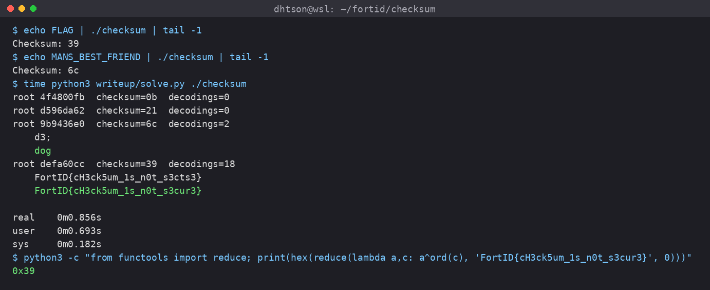

## The Challenge

*Checksum*

*Description*

*Surely you can't recover anything based on a one-byte checksum...*

The attachment `checksum_v3.tar.gz` only contains one file named `checksum`:

```text
checksum: ELF 64-bit LSB pie executable, x86-64, dynamically linked, for GNU/Linux 3.2.0, not stripped
```

Running it asks for a variable name and prints one byte:

```bash
$ echo MANS_BEST_FRIEND | ./checksum
Enter a variable to calculate the checksum for or type 'help' for more info:
Available variables:
 - AZURE_API_KEY
 - DB_PASSWORD
 - MANS_BEST_FRIEND
Checksum: 6c
```

The `help` text is a joke company page. They call the algorithm "SFSN161", claim the secret never exists in memory in plain text, and say one byte is enough because "Job security". Only three variables are listed, but `FLAG` also works:

```bash
$ echo FLAG | ./checksum | tail -1
Checksum: 39
```

The output for `FLAG` is one byte, so it cannot uniquely identify the secret. Recovering the flag requires inspecting the code that produces that byte. The final flag is:

```text
FortID{cH3ck5um_1s_n0t_s3cur3}
```

The solve follows the generated functions in call order, then searches for boundaries where groups of XOR operations reconstruct individual characters.

## The Walkthrough

### First look

The Rust binary retains its symbols. Disassembling it with demangled names makes the generated checksum functions easy to separate from the runtime:

```bash
objdump -dC -M intel --no-show-raw-insn ./checksum > checksum.asm
```

`-d` disassembles executable sections, `-C` demangles symbol names, and `-M intel` selects Intel syntax. The solver uses this same output, without instruction bytes, as its input.

`main` maps the variable name to one function and calls it on a one-byte state starting at `0`. Besides the usual Rust runtime, there are 5030 generated functions named like this:

```text
checksum::checksum_<40 hex chars>_
```

Every one of them looks like this:

```text
<checksum::checksum_3cdaed329668ea856ea0cdfe6f8b457f8b5ee9c4_>:
  push   rbx
  mov    rbx,rdi
  xor    BYTE PTR [rdi],0xa7
  call   <checksum::checksum_0b93ff370658a8a604a4bcaa30a457a84bfa7929_>
  mov    rdi,rbx
  call   <checksum::checksum_05f6ae5f31c2aac77e57eea3a2917e4c9c7434e3_>
  ...
```

Here, `rdi` points to the checksum byte. The function saves that pointer in `rbx`, XORs `0xa7` into the byte, then passes the pointer to its children. A `not` on the byte has the same effect as XOR with `0xff`.

For each generated function, the parser records `own`, the XOR of its immediate constants, and `kids`, its child functions in disassembly order. It also treats a jump to another generated function as a child, covering tail calls. The generated functions form a directed acyclic graph (DAG) with one root per variable and a shared pool of 257 leaf functions that each apply one XOR.

Because every operation updates the same byte with XOR, a function's total effect can be computed recursively:

```text
effect(f) = own(f) ^ effect(child_0) ^ effect(child_1) ^ ...
```

Applying this evaluator to the roots reproduces the recorded outputs `0b`, `21`, `6c`, and `39`. That checks the extracted XOR model against the program's output for all four variables. It does not yet recover the secrets, since each root still collapses to one byte.

### Dead end: the function names

The 40-hex names suggest SHA-1 digests. Testing hashes of short strings and integers, as well as Merkle-style hashes of child identifiers, produced no match. The child-hash tests covered hexadecimal and raw-byte representations, both in call order and sorted order.

These failed tests do not prove that the identifiers are random. They leave no useful naming rule for this solve, so the parser treats the names as opaque identifiers. The physical layout of functions also supplied no decoding rule; the next step uses the order of calls inside each function.

### `dog`

The XOR-only computation suggests testing whether the output equals the XOR of the secret's characters. `MANS_BEST_FRIEND` supplies a likely known plaintext, `dog`:

```text
'd' ^ 'o' ^ 'g' = 0x64 ^ 0x6f ^ 0x67 = 0x6c
```

This matches the binary's `6c`, although a one-byte match alone is weak evidence. The call graph provides a second measurement: the number of function visits in an expanded depth-first traversal.

Start at a root, append its own XOR constant, then recursively visit each child in call order. A shared function must appear again every time a call reaches it. Using a global `visited` set would discard repeated calls and change both the checksum and the sequence used for decoding.

The traversal in the final script is:

```python
def preorder(n, out):
    out.append(funcs[n]["own"])
    for k in funcs[n]["kids"]:
        preorder(k, out)
    return out
```

Each entry represents one function visit, with that function's local XOR constants combined into `own`. The recorded lengths are:

```text
AZURE_API_KEY     5817 visits
DB_PASSWORD       2748 visits
MANS_BEST_FRIEND   484 visits
FLAG              4850 visits
```

If `dog` corresponds to three character blocks, its 484 visits average about 161.33 visits per character. In particular, `484 = 161 + 161 + 162`, which suggests trying blocks of length 161 or 162. The `SFSN161` name supports that guess, but the block XORs still need to produce the expected letters.

The flag root has 4850 visits. At roughly the same block size, that suggests a 30-character string: `30 * 161 = 4830` and `30 * 162 = 4860`. The other root lengths are compatible with roughly 36 and 17 characters, respectively; those lengths remain estimates until a decoding supports them.

### Recovering the characters

### Testing character boundaries

The next hypothesis is that each character occupies a contiguous block of visits in preorder. This requires preserving the local-operation-then-children order seen in the disassembly. Sorting the children or visiting each shared node only once would lose that ordering.

Let `seq[i]` be the local XOR constant at visit `i`, using zero-based indices. Build a prefix XOR array with one extra initial entry:

```text
P[0] = 0
P[i+1] = P[i] ^ seq[i]
```

For the half-open block `seq[b:b+L]`, its XOR is `P[b+L] ^ P[b]`. Both prefixes contain the entries before `b`; XORing the prefixes cancels those entries because `x ^ x = 0`. Each proposed block can therefore be checked with two array lookups.

Searching the 161/162 splits of `MANS_BEST_FRIEND` yields `dog` as one decoding. The recorded solver output also contains `d3;`, so even this known-plaintext example is ambiguous under the block rule. The variable name supplies the reason to prefer `dog`.

For `FLAG`, the same search produces candidates beginning with `FortID{`. That agreement with the expected flag prefix gives a stronger test of the block hypothesis than the final checksum alone.

### Searching the remaining blocks

The recursive search keeps a boundary `b` and the string decoded so far. At each boundary it tries lengths 161 and 162, computes the block XOR, and continues only when the result falls in `0x21..0x7e`, the visible ASCII range used by the script. This excludes spaces as well as control bytes.

When at most 162 visits remain, the script consumes the entire remainder as the final block. That is a search convention in this solver; it allows a shorter final block rather than requiring every block to have length 161 or 162. A candidate is complete only when the search consumes all visits.

Keeping both possible lengths avoids committing to a boundary too early. A printable character at one position can still lead to a dead end later. Prefix XOR makes each check constant-time, while the ASCII filter cuts branches as soon as a block produces an invalid byte.

The recorded run leaves 18 visible-ASCII decodings for `FLAG`. Filtering those strings with `FortID\{[0-9A-Za-z_]+\}` leaves two:

```text
FortID{cH3ck5um_1s_n0t_s3cts3}
FortID{cH3ck5um_1s_n0t_s3cur3}
```

The second candidate reads as leetspeak for "checksum is not secure". Both candidates XOR to `0x39`: every complete partition covers the same sequence, so XORing all decoded characters must reproduce the root checksum. Matching `0x39` checks consistency, but cannot select one candidate over the other. The original solve records that the `s3cur3` candidate was submitted and accepted.

`AZURE_API_KEY` and `DB_PASSWORD` produce no decoding under this visible-ASCII rule. The result alone does not distinguish between non-printable secrets and a block model that does not fit those roots. Recovering those variables is unnecessary for the flag.

## Final Exploit

The script below combines the parser and boundary search. It finds roots by counting incoming edges within the generated-function graph: a root has no caller among those functions, although `main` can call it. The script prints the root identifier and checksum rather than assigning variable names; the recorded program outputs identify the `6c` root as `MANS_BEST_FRIEND` and the `39` root as `FLAG`.

```python
#!/usr/bin/env python3
# usage: python3 solve.py ./checksum
import re, subprocess, sys
from collections import Counter

sys.setrecursionlimit(100000)
binary = sys.argv[1] if len(sys.argv) > 1 else "./checksum"
asm = subprocess.run(["objdump", "-dC", "-M", "intel", "--no-show-raw-insn", binary],
                     capture_output=True, text=True).stdout

# 1. parse every checksum_<sha1>_ function into (xor constants, children)
funcs, cur = {}, None
for line in asm.splitlines():
    m = re.match(r"^[0-9a-f]+ <checksum::checksum_([0-9a-f]{40})_>:", line)
    if m:
        cur = funcs.setdefault(m.group(1), {"own": 0, "kids": []})
        continue
    if not line.strip():
        cur = None
    if cur is None:
        continue
    if m := re.search(r"xor\s+BYTE PTR \[r(?:di|bx)\],(0x[0-9a-f]+)", line):
        cur["own"] ^= int(m.group(1), 16)
    elif re.search(r"\tnot\s+BYTE PTR", line):
        cur["own"] ^= 0xFF
    elif m := re.search(r"(?:call|jmp)\s+[0-9a-f]+ <checksum::checksum_([0-9a-f]{40})_>", line):
        cur["kids"].append(m.group(1))

# 2. roots = generated functions nobody calls (one per variable, FLAG included)
indeg = Counter(k for f in funcs.values() for k in f["kids"])
roots = [n for n in funcs if indeg[n] == 0]

def preorder(n, out):
    out.append(funcs[n]["own"])
    for k in funcs[n]["kids"]:
        preorder(k, out)
    return out

# 3. prefix XOR over the preorder walk; each 161/162-node block XORs to one char
PRINTABLE = set(range(0x21, 0x7F))

def decode(n):
    seq = preorder(n, [])
    P = [0]
    for c in seq:
        P.append(P[-1] ^ c)
    N, res = len(seq), []
    def go(b, s):
        if b == N:
            res.append(s)
            return
        rem = N - b
        for L in (161, 162) if rem > 162 else (rem,):
            if (P[b + L] ^ P[b]) in PRINTABLE:
                go(b + L, s + chr(P[b + L] ^ P[b]))
    go(0, "")
    return P[-1], res

for r in roots:
    chk, cands = decode(r)
    flags = [c for c in cands if re.fullmatch(r"FortID\{[0-9A-Za-z_]+\}", c)]
    print(f"root {r[:8]}  checksum={chk:02x}  decodings={len(cands)}")
    for c in (flags or cands)[:8]:
        print("   ", c)
```

Recorded output (about 0.856 seconds in the saved run):



```text
root 4f4800fb  checksum=0b  decodings=0
root d596da62  checksum=21  decodings=0
root 9b9436e0  checksum=6c  decodings=2
    d3;
    dog
root defa60cc  checksum=39  decodings=18
    FortID{cH3ck5um_1s_n0t_s3cts3}
    FortID{cH3ck5um_1s_n0t_s3cur3}
```

The saved output matches the binary's checksums for `MANS_BEST_FRIEND` and `FLAG`, includes `dog` among the candidate decodings, and gives the following checksum for the selected flag:

```bash
$ python3 -c "from functools import reduce; print(hex(reduce(lambda a,c: a^ord(c), 'FortID{cH3ck5um_1s_n0t_s3cur3}', 0)))"
0x39
```

## Why This Works

A one-byte checksum has only 256 possible values, so many secrets share it. The executable also exposes intermediate XOR operations and their call order. The successful block search is consistent with a generator that groups operations by character:

```text
secret = c0 c1 c2 ... c29
  ↓ generator
for each ci: a block of visits whose local constants XOR to ci
  ↓ compiled as nested calls
call DAG of checksum_<id>_ functions
  ↓ preorder walk keeps each block contiguous
search 161/162 boundaries, allowing a final remainder block
  ↓ block XORs
candidate characters
```

XOR is commutative, so rearranging all operations preserves the final byte. Character recovery depends on their grouping, however: moving an operation across a proposed block boundary can change both decoded characters while leaving the whole checksum unchanged.

The known plaintext `dog` supplies a plausible block size, and `FortID{` tests that size on a different root. The search then narrows the flag to two candidates. The readable sentence selects `s3cur3`, with the recorded competition acceptance providing the final check that the checksum itself cannot supply.

```text
FortID{cH3ck5um_1s_n0t_s3cur3}
```


